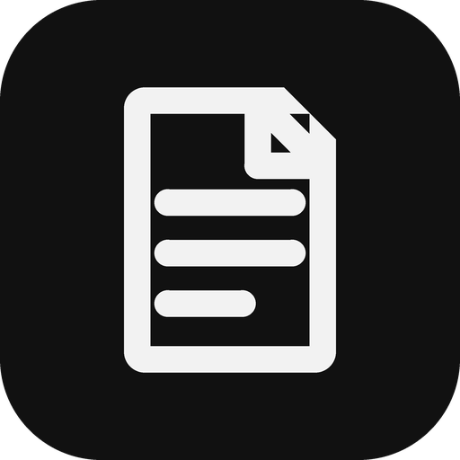
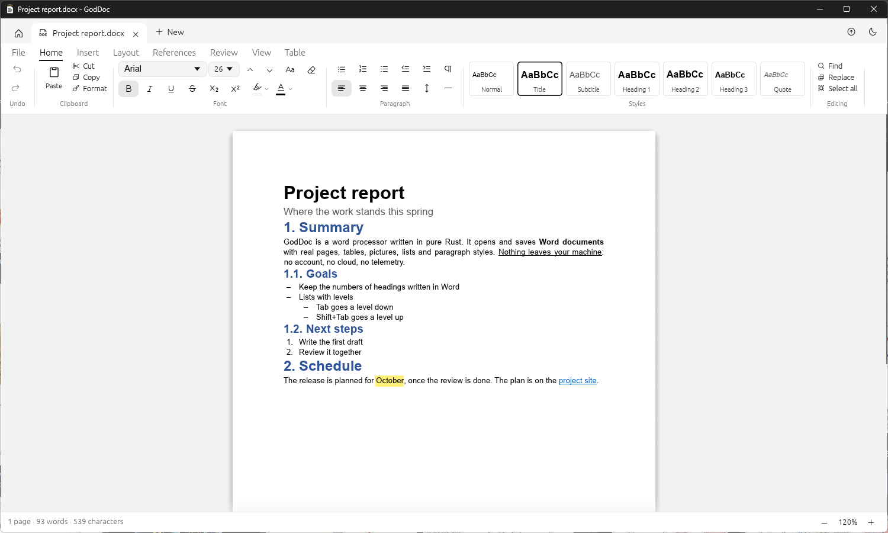

<p align="center"></p>

<h1 align="center">GodDoc</h1>
<p align="center">A word processor in pure Rust. Local: no account, no cloud.</p>

<p align="center"></p>

## Download

Windows: get `GodDoc-windows-x64.exe` from the [latest release](https://github.com/0XLUC4/GodDoc/releases/latest).
It is a single file, nothing to install. It is not signed, so Windows SmartScreen may ask before running it.
New versions come through the Updates button: it downloads one and restarts on it.

## Features

- Rich text: bold, italic, underline, strikethrough, superscript, subscript, highlight, twenty fonts shown in their own letters, sizes, a palette of colors, change case, clear formatting, format painter.
- A ribbon of tabs (File, Home, Insert, Layout, References, Review, View, Table), each in named groups; on Home, a gallery of styles that shows each as it writes.
- Paragraph styles (Normal, Title, Subtitle, Heading 1-3, Quote), alignment (left, center, right, justified), horizontal lines.
- Paragraph measures to type or drag: indent left and right (cm), first line or hanging indent, space before and after (pt), line spacing (single, 1.15, 1.5, double or any multiple).
- Lists with levels: bullets, numbers and dashes. `- `, `* ` or `1. ` starts one, Tab goes a level down, Shift+Tab a level up.
- Numbered headings that count through the document: 1. then 1.1. then 1.1.1. Tab makes a heading a sub-heading.
- Word files: opens and saves `.docx`. The styles of a file are read (fonts, sizes, colors, alignment), and headings numbered in Word keep their numbers.
- Real pages that fill up and continue on the next one; page breaks (Ctrl+Enter), blank pages, paper size (A4, A3, A5, Letter, Legal), orientation, named margins or each side set apart (cm), page numbers, a header and a footer on every page (left, middle and right, with the page number and the count of pages).
- Table of contents written from the headings, with their numbers and pages.
- Tables: cells hold formatted text, Tab moves to the next cell; rows and columns can be added and removed.
- Pictures (PNG, JPEG): drag to move, corners to resize; any paragraph or table moves by its margin grip.
- Find and replace (Ctrl+F), date and special characters, formatting marks for spaces and ends of paragraphs.
- Printing through the print dialog of Windows (Ctrl+P), and export to PDF: the pages come out as the screen shows them.
- Export to Markdown and to a web page; also opens and saves `.txt`.
- Navigation pane of headings, home screen with recent documents, several documents in tabs, undo / redo, dark and light theme, word count, zoom to the page width or the whole page, a page-only view (Esc leaves it).

- Links (Ctrl+K; Ctrl+click opens them), comments in a pane beside the text, tracked changes to accept or reject.
- Text in two or three columns, table cells joined across columns, pictures with the text beside them.
- Spelling in English and French, checked on this computer: wrong words are underlined, a right click offers others. The dictionary of a language is fetched once, when it is first asked for.
- Exported PDFs carry their text: it can be selected, copied and searched.

Not there yet: cells joined across rows, columns that differ within a document, text that runs around a picture below its own paragraph, grammar.

## Build

```
cargo run --release
cargo test --workspace
```

Layout: `crates/core` (document model, `.docx` reading and writing, export), `crates/app` (egui app).

## License

MIT OR Apache-2.0
